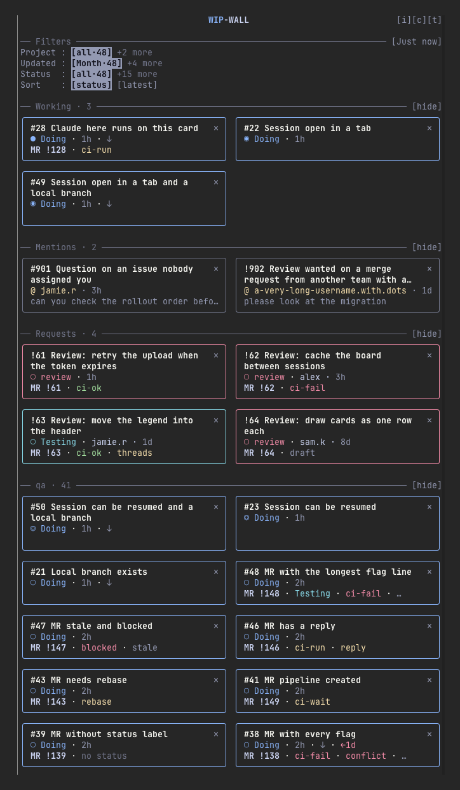
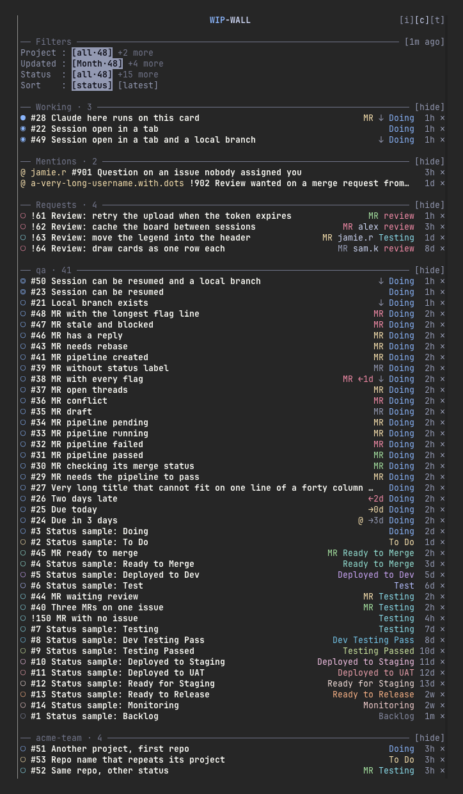

<div align="center">

# WIP-WALL

Your assigned GitLab issues and merge requests, docked beside the transcript as a Claude Code mod.

<p>


</p>

<table>
<tr>
<td align="center"></td>
<td width="24"></td>
<td align="center"></td>
</tr>
<tr>
<td align="center"><sub><b>Cards</b> (default)</sub></td>
<td></td>
<td align="center"><sub><b>Compact</b> (press <code>[c]</code>)</sub></td>
</tr>
</table>

</div>

Every card is an issue coloured by its `Status::` label, with its merge request, pipeline and review state under the title. Press a card and Claude opens in your local clone of that project: in a new Ghostty window, a tab or a split, or right where you are. Press a card whose Claude is still running and it comes to the front; press one whose Claude has exited and the same session resumes.

## Highlights

| | |
| --- | --- |
| **Working** | Cards with an open window or tab, plus the card of the session you are in, sit at the top whatever the filters say. |
| **Mentions** | Pending `mentioned` and `directly_addressed` to-dos, so nobody waits on you unseen. |
| **Requests** | Merge requests waiting for your review: unreviewed, review started or unapproved. |
| **MR state** | Pipeline, approvals, conflicts, open threads, stale and blocked, as one coloured line per merge request. |
| **Branches** | `↓` marks an issue that already has a local branch named after it. |
| **Filters** | Project, repo, status, last update, and a `Sort` row: board status or latest first. |
| **Dismiss** | `✕` hides a card until it next changes. |
| **Themes** | Six themes on `[t]`, each checked for readable contrast. |

## Install

Requires macOS with [Ghostty](https://ghostty.org), [`glab`](https://gitlab.com/gitlab-org/cli) logged in (`glab auth login`) and your project clones in one folder.

```sh
./install.sh            # add the marketplace and install the mod
./install.sh uninstall  # remove both
```

Or by hand, with the repository URL:

```sh
claude plugin marketplace add https://github.com/klaokamol/wip-wall.git
claude plugin install wip-wall@wip-wall-local
```

Update with `claude plugin update wip-wall@wip-wall-local`, then `/reload-plugins`. To try it for one session without installing: `claude --plugin-dir /path/to/wip-wall`.

## First run

1. Start `claude` and run `/wip-wall setup`. The pane shows a checklist: `glab` found, GitLab login, Ghostty installed, Ghostty control allowed, and your clone folder with how many clones it matched. Each line that fails says what to run.
2. If the clone folder is wrong, press one of the folders the pane lists, or run `/wip-wall setup ~/path/to/clones`. The choice is remembered.
3. Press `[done]`, then `/wip-wall`: your real issues, merge requests and mentions load. `/wip-wall mock` shows sample cards instead and fetches nothing.

If Ghostty is running when you run setup, macOS may ask whether your terminal may control it; allow it. If Ghostty is not running, macOS asks on the first card you open.

## Using the pane

### Opening a card

Press a card's title. Its last row becomes a chooser:

```
open: [window] [tab] [split] [here] [×]
```

| Place | What happens |
| --- | --- |
| `window` | A new Ghostty window in the card's clone. |
| `tab` | A new tab in the front window. |
| `split` | A split to the right of the focused terminal, in the front window's selected tab. |
| `here` | Only when this session is already in that clone: the card's link goes into your prompt (or `/resume <id>` when the card has a saved session). |

The places always read `here`, `split`, `tab`, `window`; the last one you chose is drawn bold. A new Claude starts with the card's link typed into the prompt and not submitted; you press Enter yourself.

### Markers

`[i]` in the header shows this legend under it.

| Marker | Meaning |
| --- | --- |
| `○` | No session yet |
| `◎` | A saved session you can resume |
| `◉` | Claude is open in a window or tab |
| `●` | The session you are in (it pulses) |

A Claude you started by hand on a branch named after an issue claims that card, so other panes show it in Working. A card you pressed `[here]` is never taken over by the branch.

### Header

| Button | What it does |
| --- | --- |
| `[i]` | Show or hide the marker legend |
| `[c]` | One line per card instead of boxes |
| `[t]` | Cycle themes: `catppuccin`, `neon`, `tokyo-night`, `rose-pine`, `gruvbox`, `cyberpunk` |
| age (`[1m ago]`) | When the board was fetched; press it to refresh |

Working, Mentions, Requests and every project section fold with their `[hide]` / `[show]`. Only one session shows the pane at a time: a second Claude started by hand in a split stays bare, and `/wip-wall` there opens a pane anyway.

### Commands

| Command | What it does |
| --- | --- |
| `/wip-wall` | Open and refresh the pane |
| `/wip-wall setup [folder]` | Check this machine and, with a folder, choose where your clones live |
| `/wip-wall mock` | Show sample cards, fetch nothing |

## Where your clones live

WIP-WALL searches one folder, four levels deep, for git clones and matches each clone's `origin` remote to a GitLab project. It uses the first of these that applies:

1. `$WIP_WALL_ROOT`
2. the folder you chose with `/wip-wall setup`
3. the first that exists of `~/Developer/Project-Work`, `~/Developer`, `~/Projects`, `~/src`, `~/code`

Folder names do not matter: a clone is found by its remote url, so a project whose clone is missing, or whose remote could not be read, gets a "No local clone" toast instead of opening in the wrong repository.

## Settings

| Variable | Default |
| --- | --- |
| `WIP_WALL_GLAB` | `glab` on `PATH` (also looks in `/opt/homebrew/bin` and `/usr/local/bin`) |
| `WIP_WALL_HOST` | the host chosen with `/wip-wall setup host <host>`, then `GITLAB_HOST`, then `glab config get host` |
| `WIP_WALL_ROOT` | the folder chosen with `/wip-wall setup`, else the first existing folder listed above |

`WIP_WALL_ROOT` wins over a chosen folder, which suits a shell profile.

<details>
<summary><strong>Permissions</strong>: what it reads, runs and stores</summary>

<br>

WIP-WALL is a mod: it runs inside your Claude Code session with your own rights and asks for none of its own.

**GitLab (read only).** It calls `glab api` with your `glab` login, so it can see exactly what your account can see. It reads your assigned issues, your assigned merge requests and the merge requests waiting for your review (two GraphQL queries, including pipeline, approvals and recent notes) and your pending `mentioned` and `directly_addressed` to-dos. It never writes to GitLab: no comments, no label changes, no to-do changes. It talks only to your configured GitLab host.

**Your machine.**

- `find` under the clone root (depth 4) for `.git` folders, and `git` to read each clone's `origin` url and local branch names. No file contents are read. After every prompt you submit it runs one `git branch` in the session's folder, to follow a branch switch.
- `find` and `stat` under `~/.claude/projects` for the names and times of saved session transcripts, `ps` to see which Claude session ids are running, and Claude Code's own `sessions/<pid>.json` files to match a running `claude` to its session id, so a card knows whether its session is open or resumable.
- `osascript` to open or focus Ghostty windows and tabs, and `open` to show a link in your browser (http and https only). The first use triggers a macOS Automation prompt. `/wip-wall setup` also asks Ghostty its name, only when Ghostty is already running, to check that control is allowed; it never starts Ghostty. It also runs `glab auth status` to check your login.

**Claude sessions it starts.** Pressing a card runs `claude --session-id <id>` in the card's clone, with the card's url typed into the prompt (or `/resume <old id>` when the card already had a session). You press Enter yourself; nothing is submitted for you. The new session has your normal Claude Code permissions. For a mention, the typed url comes from whoever mentioned you, so treat it as you would any link a colleague sends before pressing Enter.

**What it stores.** Claude Code keeps, across sessions, which cards you dismissed, which Claude session belongs to which card, which session currently shows the pane, your pane choices (theme, where to open, folds, the legend, compact rows, sort), the clone folder and GitLab host you chose in setup and a cache of the last board (card titles, labels, branches) so the pane draws before the first refresh. It writes nothing else to disk and sends nothing anywhere except the GitLab requests above.

</details>

<details>
<summary><strong>Troubleshooting</strong></summary>

<br>

| What you see | Fix |
| --- | --- |
| `glab not found` | `brew install glab`, or set `WIP_WALL_GLAB` to its path |
| `GitLab host unknown` | `glab auth login`, run `/wip-wall setup host <host>`, or set `WIP_WALL_HOST` |
| `clone root or sessions folder unknown` | none of the default folders exist: run `/wip-wall setup ~/path/to/clones`, or set `WIP_WALL_ROOT` |
| `No local clone of <project> under <root>` | clone the project under that root; if you moved or renamed it on GitLab, run `git remote set-url origin <new url>` in the clone |
| Pane is blank | run `/wip-wall`; if it stays blank, run `claude --debug` and look for a `wip-wall:` line |
| A card will not open | check `glab auth status` and that Ghostty may be controlled (System Settings, Privacy and Security, Automation) |
| Board looks old | the age button in the header shows when it was fetched; press it to refresh |

</details>

## Development

```sh
claude plugin validate .                        # manifest, hooks and the state contract
claude plugin test .                            # every *.test.ts / *.test.tsx under the folder
npx -y -p typescript@5.9.3 tsc --noEmit -p .    # typecheck; must print nothing
claude --plugin-dir .                           # load the mod for one session
```

`CLAUDE.md` describes the architecture and the engine's gotchas.

## License

MIT, see `LICENSE`.
